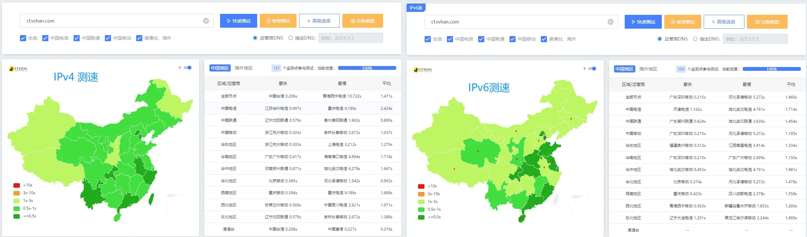

# CloudflareIP-dnspod-ddns

Select the best Cloudflare IP and update DNSPod automatically every 15 minutes.

### 1. Self-hosting

> Add IPv4 and IPv6 records for the subdomain in DNSPod before starting the script.

```js
# Install dependencies
npm i
```

```js
# Start the service
npm run dev
```

### 2. Using the existing service

> The public `CNAME` domain maintained by the author is `*.cf.cname.vvhan.com`, with support for both `IPv4` and `IPv6`.

> The public `CNAME` may route search-engine crawlers to another server. You can avoid this by using a custom CNAME address.

> For example, configure `custom.cf.cname.vvhan.com` as `xixi-haha` and point it to `xixi-haha.cf.cname.vvhan.com.`

### 3. Automatic updates

> The script runs as a `Server` service and updates automatically every `15` minutes. You can also trigger an update manually at `http://localhost:52100/updateCloudflareIp`.

### Speed test

Example site for testing the selected IP: https://cf.vvhan.com


